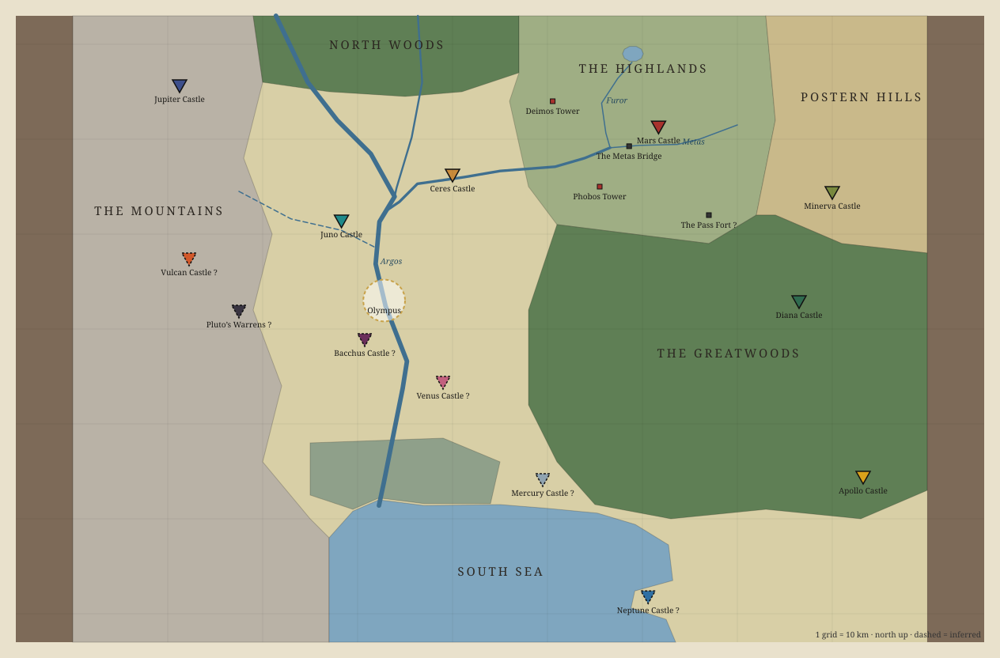

# World of Red Rising

Explorable 3D worlds from Pierce Brown's *Red Rising* saga, in the browser.

**World #1 — The Institute.** A painterly, interactive diorama of the valley where the Gold children wage war:
the misty highlands of House Mars, the Argos running to the South Sea, the Greatwoods, all thirteen Houses
(including the one that isn't on the map) and the floating mountain of Olympus. Fly in to any castle, read
lore placards with page references, and switch between summer and the winter the Argos froze.

> Status: **M0 Foundations complete**: research, decisions, contracts, graybox skeleton and pipeline.
> See the [task board](docs/TASKS.md) for what's next.



## Run it

```bash
npm ci
npm run dev        # http://localhost:5173
npm run check      # typecheck + lint + tests + build
npm run shot       # render screenshots of named views → screenshots/
```

URL parameters: `?view=castle-mars`, `?season=winter`, `?intro=0`, `?ui=0`, `?quality=low`; hash `#olympus` selects a place.

## How this project is built

A small multi-agent team: an **Opus** lead plans, owns the contracts and reviews; **Sonnet** builder agents
each take one ticket in an isolated git worktree. The human is the product owner.

| Doc | What it is |
|---|---|
| [PRODUCT.md](docs/PRODUCT.md) | Vision, audience, scope, success criteria, milestones |
| [DESIGN.md](docs/DESIGN.md) | Art direction, palette, materials, UI, motion, review checklist |
| [ARCHITECTURE.md](docs/ARCHITECTURE.md) | Stack, coordinates, contracts, ownership, budgets |
| [TASKS.md](docs/TASKS.md) | Ticket board with acceptance criteria |
| [AGENT_PLAYBOOK.md](docs/AGENT_PLAYBOOK.md) | How agents are briefed, reviewed and merged |
| [CONTENT_GUIDE.md](docs/CONTENT_GUIDE.md) | How lore placards are written and cited |
| [research/institute-canon.md](docs/research/institute-canon.md) | What the book says, with page references |
| [learning/](docs/learning/) | Build journal and deep dives (multi-agent building, design, product) |

## Credits and disclaimer

An unofficial, non-commercial fan project. *Red Rising* and its characters, places and story are © Pierce Brown
and his publishers; this project is not affiliated with or endorsed by them. No text from the books is
reproduced beyond short quotations for commentary, each cited by page. All 3D content, maps and House
sigils here are original work generated in code.
