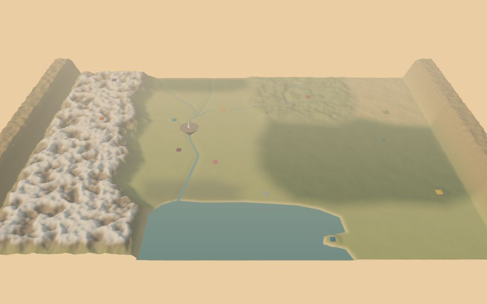

# Journal 00 — Planning: from a PDF to a buildable plan

*Phase: M0 Foundations · Lead: Opus · Human: product owner*

## What happened

1. **Research before questions.** Before asking anything, the lead pulled the text out of the book PDF and
   searched it for geography (castles, rivers, distances, Olympus). Two discoveries changed the plan:
   - The book **prints its own map of the valley** (front matter). That gave us a canonical layout, so
     "where is everything?" became a measurement task rather than an invention task.
   - The text says "twelve Houses" but names **thirteen** with students. The map shows 12 castles; Pluto's is
     underground. The contradiction turned into a feature: "the House that isn't on the map."
2. **Eight decisions in two rounds of questions.** Experience (living diorama), look (painterly), v1 scope
   (places + lore + seasons), hosting (public + Pages), your role (milestone reviews), learning
   (journal + deep dives), unknown Houses (infer + label), audience (Book 1 readers).
3. **Contracts first.** The lead wrote the world layout (every castle, river and region in km coordinates),
   the Heightfield interface, the store, shared shader uniforms and the content schema, each protected by tests.
4. **A runnable graybox.** An ugly but complete skeleton: terrain from the layout, water, clickable
   placeholder castles, camera flights, a HUD, and a screenshot tool so agents can *see* their work.
5. **Specs and a ticket board.** PRODUCT, DESIGN, ARCHITECTURE, TASKS, CONTENT_GUIDE, AGENT_PLAYBOOK, CLAUDE.md.

## Decisions and why

| Decision | Why | Alternative we rejected |
|---|---|---|
| Measure positions from the printed map at 20 px/km | Gave a ~90 km valley, matching the text's "50 km west + 40 km east" walls, an independent cross-check | Eyeballing from text alone: the text's directions are inconsistent in places |
| World units = km, landmarks ×4 | One unit system for every agent; exaggeration is a *design* choice made once, centrally | True scale: castles would be invisible specks from the overview |
| Procedural everything, no downloaded models | Small repo, no licensing risk, agents can edit everything as code | Asset packs: faster first look, but inconsistent style and licence tracking |
| R3F (React Three Fiber) over plain three.js | One component per system means one ticket per folder; drei saves weeks | Plain three.js: fewer abstractions, but a single scene graph file everyone edits |
| A working skeleton before any agent starts | Agents build against real interfaces with real data and can verify against the running app | Spec-only kickoff: agents would invent incompatible scaffolding in parallel |
| Rolling-wave planning | M1 is specified in full; M2–M4 stay coarse until M1 teaches us what we got wrong | Full upfront detail: expensive and wrong by M2 |

## What went wrong (and the fix)

- **The text and the map disagree on the rivers.** The text calls the Furor "eastern" and the Metas
  "western". On the map the river just south of the castle comes from the east. Fix: geometry follows the map, names follow the
  text ("the Metas runs just south of our castle"), and the discrepancy is documented. **Lesson:** sources
  conflict. Decide a precedence rule once ("printed map for geometry, text for names and details") and write it down.
- **The first heightfield took 1.5 s at medium resolution** (per-sample polygon distance maths with allocations).
  Acceptable for a graybox; it became an explicit performance requirement in T01 (Web Worker, spatial
  acceleration, numbers in the report) rather than something the lead quietly fixed. **Lesson:** turn
  problems you find during setup into acceptance criteria.
- **A golden-example fact was slightly wrong.** The first draft said Phobos and Deimos fell "while Darrow stormed
  Olympus". Re-reading the text: Jupiter's army besieged Mars Castle during the thaw. Fixed before any
  agent copied it. **Lesson:** golden examples get copied *exactly*, mistakes included, so check them more carefully than anything else.

## Product-thinking notes

- **Audience drives spoilers, tone and polish.** "Readers of Book 1" let placards be direct about events, and
  "shared publicly" raised the bar on load time and phones.
- **Trust is a feature.** Fans argue about canon, so the confidence badges (canon / inferred / invented) and
  "why here?" notes make our guesses honest and arguable instead of silently wrong.
- **Non-goals are decisions.** Saying "the timeline is v2" protects v1's quality. The data model still
  tags events by season, so v2 doesn't need a rewrite.

## What we'd do differently

- Look for maps, appendices and glossaries in the source **first**. They're the highest-density information in a book.
- Write the contract tests *while* writing the contracts (we did), and add a visual "contract": the
  `layout-preview.svg` made checking against the book map a one-glance job.
