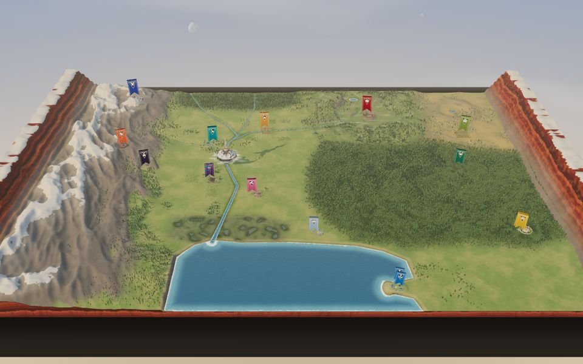
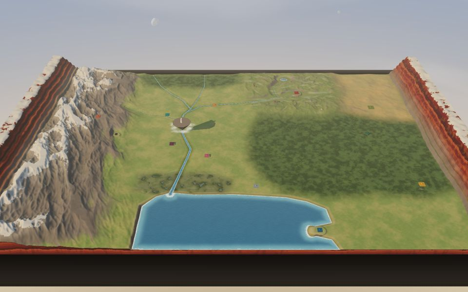
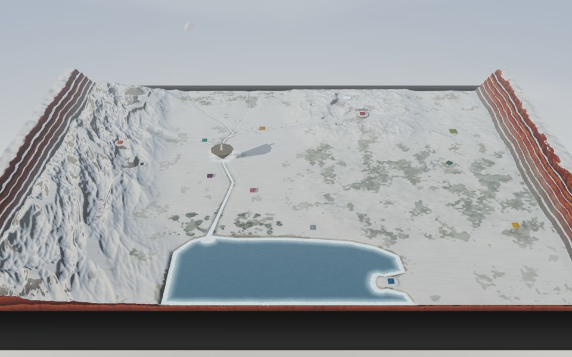
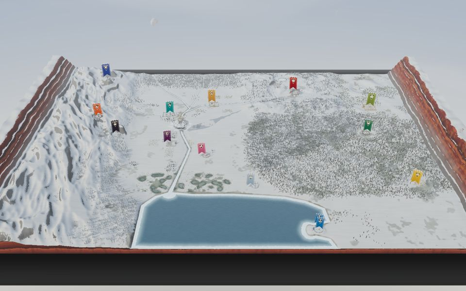
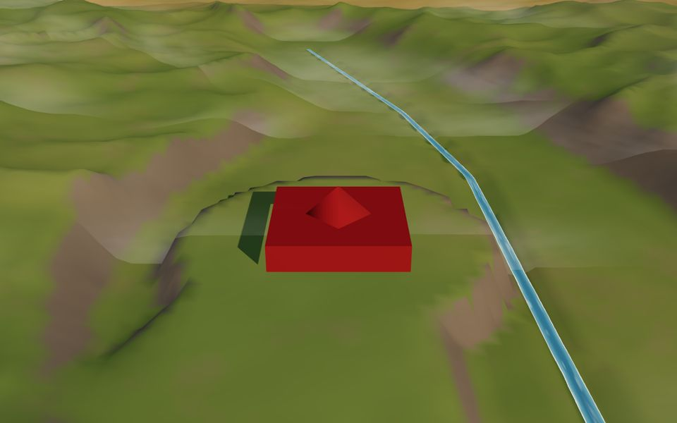
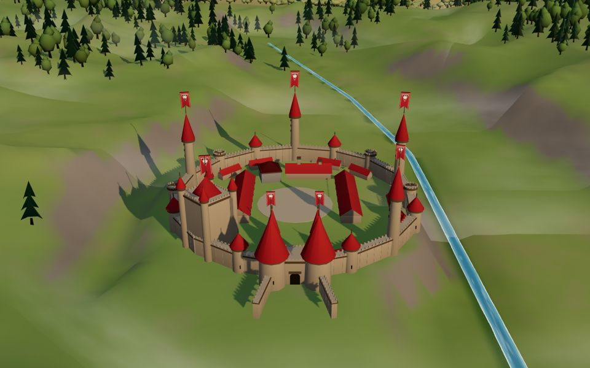
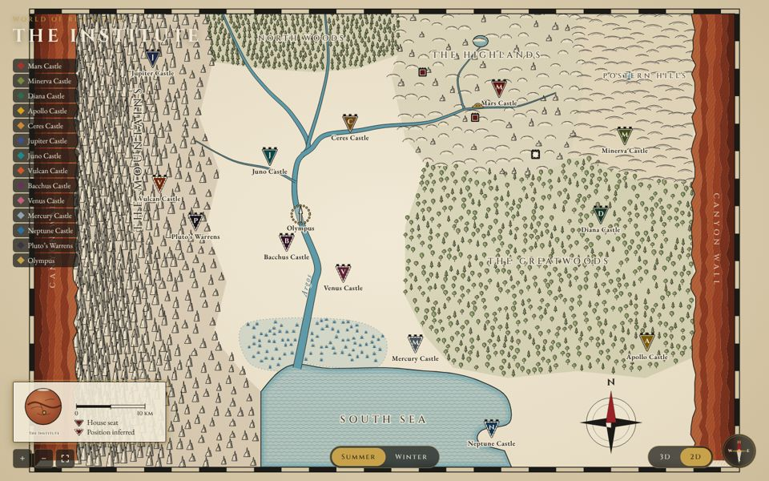
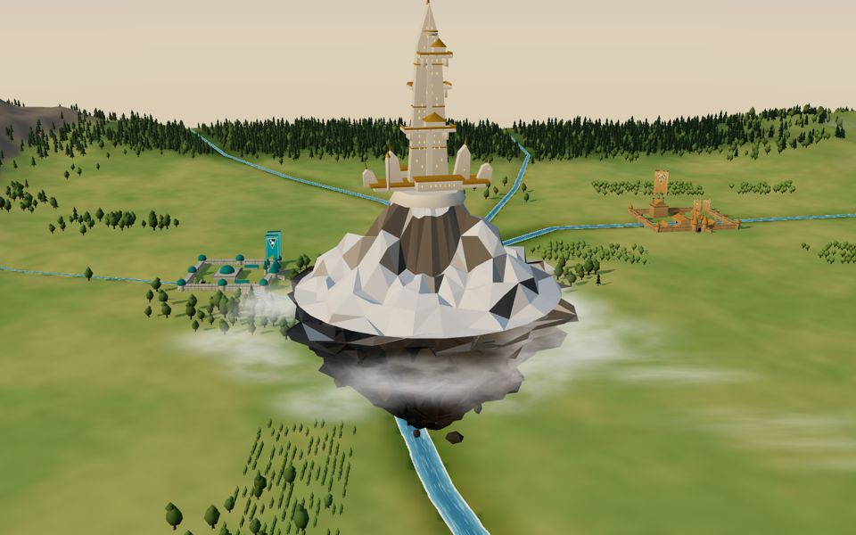

# Journal 02: M2 "The Houses" (plus a re-plan)

*Phase: M2 · Lead: Opus · Builders: 6 tickets, two waves of 3 Sonnet builders · Human: product owner*

## What happened

1. **The product owner changed the plan, and was right to.** After M1 they reported 1–2 FPS on their laptop
   and asked for a 2D map. Instead of continuing the scheduled M2 (castles, Olympus, forests, sigils), the lead
   re-planned: **performance (T14) moved up from M4**, a **2D map (T17)** was added, and M2 split into two waves.
2. **Pre-wiring before launch.** The lead added the seams first: `viewMode` and `perf` flags in the store, a 3D/2D
   switch, stubs for `Map2D`, `PerfManager`, `PerfNotice`, `Vegetation` and `Banners`, and a `2d:` screenshot view.
   So no two builders ever needed the same file.
3. **Wave A:** T05 castles, T14 performance, T17 2D map. **Wave B:** T05b banner anchors, T06 Olympus, T07 forests,
   T08 sigils and banners (T08 only after T05b, because it needed the anchors).
4. **Shipped in slices.** The 2D map went live the moment it was ready, because the product owner was stuck at
   1–2 FPS in 3D. Wave A went live next, then the zoom and refinement fixes, then wave B.

## The performance story (the most instructive part of M2)

| Step | What we learned |
|---|---|
| Product owner: "1–2 FPS" | Matched the lead's software-rendering probe almost exactly, so a strong hypothesis: no GPU in use |
| `chrome://gpu` report | Confirmed: *"WebGL has been disabled via blocklist"*; active device *Microsoft Basic Render Driver*, even though an Intel UHD 620 **and** an NVIDIA MX250 were present |
| T14: detect software GL → cheapest path + notice | 1–2 → **20–23 FPS** on the real device; notice appeared as designed |
| Product owner: "quality reduced, zooming slow" | Two separate issues, needing two separate fixes |
| Zoom: lead hypothesised a stalled render loop | **Wrong.** A precise frame timeline (old vs new code) showed frames were continuous. The real cause was *zoom feel*: aiming at screen centre, small steps, heavy smoothing |
| Quality: **progressive refinement** (T14) | Move at dpr 0.6, then render a sharp dpr-1.25 still ~250 ms after the camera stops |

**Lessons:**
- **Ask for the user's diagnostics** (`chrome://gpu`); they turned guessing into knowing.
- **Measure with an instrument precise enough for the question.** The lead's first probe sampled too coarsely and
  "showed" a stall that didn't exist. Comparing old and new code with the same accurate timeline caught it before a false fix was claimed.
- **Your test machine isn't your user's machine.** Headless software GL is vertex-bound, so T14's pixel-shader
  savings were invisible there. Only the human's device could confirm them.

## Other things that went wrong (and the fix)

| Problem | Root cause | Fix / lesson |
|---|---|---|
| One builder read an outdated ticket | Its worktree was created from a stale commit | Check every worktree's base right after launch (playbook §8.10) |
| All builders stopped mid-task | Account usage limit | Work survived in worktrees; resume with the exact state; ask for WIP commits (§8.11) |
| A test failed only after merging | Heavy suites + parallel load → 5 s timeout | Global 30 s timeout + the owner sped the test up. Flaky tests are worse than failing ones |
| 8 castles changed after their last screenshot | "Done" claimed without re-looking | Lead rendered them and caught Jupiter (too dark) and Diana (sticks). Rule: re-shoot after **every** change |
| Pluto's hillside near-black | The cliff faced east, away from a SW sun: no fill light could save it | Turn the cave toward the sun (the book doesn't specify a facing). Check **geometry vs light direction** before tuning lights |
| Olympus v1 read as a flying saucer | A dome is the easy primitive; the brief said "mountain" | Round-2 brief named the failure, gave a one-glance test, and a canon metaphor (a sword "strikes up out of the mountain") |

## Decisions and why

| Decision | Why |
|---|---|
| Ship the 2D map immediately | It unblocked the only real user, and nothing in 3D changed |
| Make `?stats=1` and `chrome://gpu` part of the workflow | Real-device data beats any amount of headless guessing |
| Software path: cheap while moving, sharp when still | Interaction needs frame rate; looking needs resolution. Do both, at different times |
| Waves of ≤ 3 builders | Usage limits; and the lead's review is the real bottleneck anyway |
| Grant one-time, single-file permissions (e.g. "only the `HouseGlyph` slot") | Lets integration happen without shared ownership; the lead verifies the diff stays in bounds |

## Before and after

| M1 | M2 |
|---|---|
|  |  |
|  |  |
|  |  |

Also new:  and 

## What we'd do differently

- Ask for real-device performance numbers at **M0**, not after M1. A `?stats=1` build on day one would have caught the
  software-GL issue before any milestone.
- When the brief says "mountain", say what it must *not* look like (dome, saucer). Negative examples prevent the obvious wrong answer.
